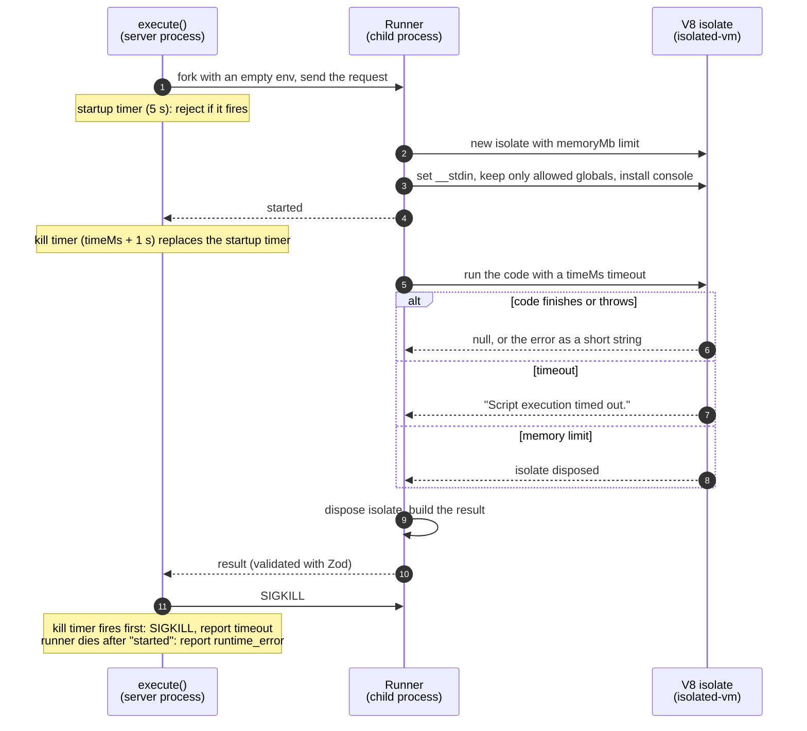

# Execution engine (COD-34)

The engine runs one piece of untrusted code with one stdin and returns what
happened. It does not know about problems, test cases, or verdicts; judging
(COD-35) builds on top of it.

- Code: `src/modules/execution/`
- Entry point: `execute(request)` in `execution.service.ts`
- Runner process: `javascript.runner.ts`; what runs inside the isolate
  before user code: `javascript.sandbox.ts`
- Tests: `execution.service.test.ts` (`pnpm --filter api test`)

## Interface

```ts
execute({
  language: "javascript",
  code: string,   // up to 100 000 characters
  stdin: string,  // up to 1 000 000 characters
  limits: { timeMs: number, memoryMb: number }, // timeMs <= 10 000, 8 <= memoryMb <= 512
}): Promise<ExecutionResult>
```

`ExecutionResult` is a union on `status`; every variant carries `stdout` (at
most 64 KB) and `durationMs` (time spent running the code, not starting the
runner):

| `status` | Meaning |
|---|---|
| `success` | The code finished within the limits |
| `runtime_error` | The code threw, left a promise rejection unhandled, failed to parse, printed more than 64 KB, or crashed its runner (`error` holds the message, at most 4 KB) |
| `timeout` | The code ran past `timeMs` |
| `oom` | The code went over `memoryMb` |

The promise resolves for anything the code does. It rejects when the engine
itself fails: an invalid request, or a runner that crashes before starting or
does not start within 5 s (for example when too many runs start at once).

The shape is language-neutral: adding a language adds a runner behind the same
`execute()`, not a new interface.

## How a JavaScript run is isolated



Each layer has one job:

- **Isolate** (`isolated-vm`): a separate V8 heap with no Node APIs inside, so
  there is no `process`, `require`, `fetch`, or file system to reach, and a
  memory limit that disposes only this isolate when exceeded. Every run gets a
  fresh isolate, so nothing carries over between runs.
- **Child process**: the kill switch. The operating system can always end a
  process, even one stuck in native code, and a crash inside it never takes
  the server down. Its env is empty, so even a sandbox escape would find no
  secrets there.

A worker thread is not enough for the kill switch: `worker.terminate()` only
interrupts JavaScript, so a worker stuck inside isolated-vm's native code
keeps running (and burning CPU) forever, and a fatal error inside it aborts
the whole server process.

`node:vm` is not used: it shares the server's heap, so any object passed in
leads back to the server's `Function` and `process`
(`this.constructor.constructor("return process")()`), and running out of
memory kills the whole server.

## Who is blamed for what

The runner sends `started` right before user code runs. That message splits
failures between the engine and the code:

| What happens | Before `started` | After `started` |
|---|---|---|
| Runner exits without a result | engine failure: reject | the code crashed it: `runtime_error` "Execution aborted" |
| Timer fires | startup timer: reject | kill timer: `timeout` |

Starting a runner therefore never counts against the code's time limit, even
when many runs start at once.

## Rules that keep the sandbox closed

Each one is covered by a test.

- **Errors leave the isolate as short strings.** The code runs inside a
  function installed in the isolate that catches every error and turns it into
  a string of at most 4 KB there, under the time limit. If a thrown object
  were copied out instead, its getters would run outside the isolate with no
  time limit, and a huge value would fill the runner's heap.
- **Unhandled rejections are the exception.** isolated-vm copies them out
  itself, reading the error's properties with no time limit. A normal error
  becomes `runtime_error`, its message cut to 4 KB in the runner. One whose
  getters never return, or that takes too long to copy, hangs the runner until
  the kill timer ends it (`timeout`). If the copy ever crashed the runner, the
  run would end as `runtime_error` "Execution aborted"; no test case reaches
  that path today.
- **`console` is built inside the isolate.** It turns arguments into one
  string with the sandbox's own `String`, and cuts the line to the output
  limit with a `slice` captured before user code runs. A hostile `toString` or
  a huge line therefore stays inside the isolate's limits.
- **Output is capped at 64 KB.** Past the cap, the runner tells `console.log`
  to stop and it throws inside the isolate; the run is reported as
  `runtime_error` even if the code catches that error and keeps going.
- **Only allowed globals survive.** `ALLOWED_GLOBALS` in
  `javascript.sandbox.ts` lists the standard built-ins user code keeps; every
  other global is deleted, so one a future V8 adds is gone by default. A test
  compares the sandbox's globals with the list, so an upgrade shows up as a
  diff to review.
- **Memory the limit does not count is removed.** isolated-vm does not count
  `WebAssembly` memory, `SharedArrayBuffer`, buffers grown with
  `ArrayBuffer.prototype.resize` / `transfer`, `Intl` objects, or the
  formatters cached by `Date.prototype.toLocaleString` /
  `toLocaleDateString` / `toLocaleTimeString` (cycling through locales,
  calendars, and numbering systems): with a 16 or 32 MB limit each of them
  allocated hundreds of megabytes to gigabytes. The globals are left out of
  the allowed list (with `Atomics`) and the methods are deleted; a date's
  `toLocaleString` then falls back to `Object.prototype.toLocaleString`, which
  returns `toString()`. Number `toLocaleString`, `localeCompare`,
  `toLocaleUpperCase`, `normalize`, and Unicode regexes stay: they also use
  the locale library, but their memory stayed flat when cycled the same way.
- **`ArrayBuffer` over the limit counts as `oom`.** isolated-vm refuses the
  allocation with a `RangeError` (which code can catch) instead of disposing
  the isolate. Code can fake this status by throwing the same error, which
  only changes its own result.

## Gotchas

- **The caller must cap concurrency.** One run is one process: about 150 ms
  and tens of megabytes to start, of which about 100 ms is loading Zod to
  validate the request. On a 16-core machine 100
  parallel runs were fine, while at 150 a third of the runners missed the 5 s
  startup timeout. The time limit is wall-clock, so heavy CPU contention can
  also turn slow code into `timeout`. The judging queue (COD-35) sets the
  concurrency.
- **The kill timer loses stdout.** It ends the runner, and with it the output
  collected so far.
- **Orphaned runners on Linux.** If the server dies while a runner hangs in
  native code (the rejection case above), the runner is not killed with it and
  keeps burning a CPU. Windows ends child processes with their parent. Running
  code in Docker with cgroups (COD-39) bounds this.
- **The runner imports local files with a `.ts` extension**
  (`./execution.schemas.ts`, `./javascript.sandbox.ts`), and so does anything
  it imports. It runs on plain Node, which strips types but
  does not resolve extensionless imports; `rewriteRelativeImportExtensions` in
  `tsconfig.json` turns them into `.js` imports on build.
- **The isolate is not an OS boundary.** The runner process can still reach
  the file system and network; only the isolate keeps the code away from them.
  Running code in Docker (COD-39) adds a boundary the kernel enforces.
