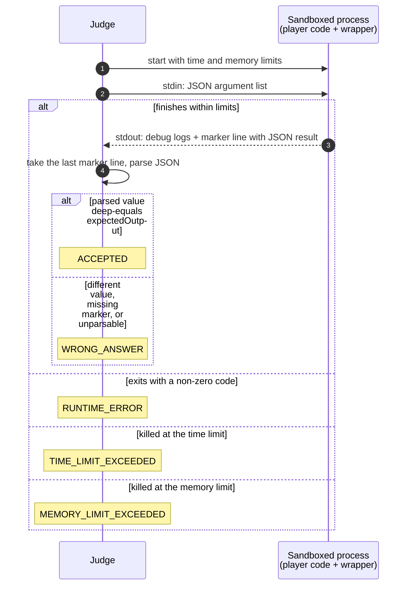

# Problems and the judging contract (COD-33)

Every match is played on one problem. The player implements a single function,
LeetCode-style; the judge calls it with each test case's arguments and compares
what it returns to the expected result.

This document fixes the contract. COD-33 implements the data side (problems,
test cases, revealing a problem to a match). Running code against it is
COD-34 (execution engine) and COD-35 (judging a submission); COD-40 adds Python.

- Shared schemas: `packages/shared/src/problem.schemas.ts`
- Data: `Problem` and `TestCase` in `prisma/schema.prisma`, seeded from
  `prisma/seed-problems.ts` (`pnpm db:seed`, safe to re-run)

## A problem

| Field | Meaning |
|---|---|
| `slug` | Stable identifier, the same in every database; the seed upserts by it |
| `statement` | Prompt shown to players |
| `signature` | The function to implement: `functionName`, ordered `params` (`name`, `type`), `returnType` |
| `timeLimitMs`, `memoryLimitMb` | Per-problem limits for one test case run |
| test cases | `input` (argument list), `expectedOutput`, `isHidden`, `order` |

Allowed types: `int`, `float`, `string`, `bool`, `int[]`, `string[]`, `int[][]`.
Each one must map to a native type in every supported language, which is why
the set is small. Trees, linked lists, and in-place (void) problems are out of
scope.

`signature`, `input`, and `expectedOutput` are JSON columns, so the database
does not check their shape. They are validated with the shared Zod schemas
both when written (seed) and when read back (`toMatchProblem`); a stored value
that fails validation is a server error, not a client one.

Function and parameter names must be plain identifiers (`^[A-Za-z_][A-Za-z0-9_]*$`)
because they are interpolated into executed wrapper code and generated starter
code.

## Test cases

A test case holds the arguments in parameter order and the expected return
value, both as JSON:

```json
{ "input": [[2, 7, 11, 15], 9], "expectedOutput": [0, 1] }
```

- **Visible** cases are sent to players as examples.
- **Hidden** cases are used only for judging, so a player cannot hardcode
  outputs. They are never read by the queries that build match payloads
  (`where: { isHidden: false }` in the select itself), so no mapping mistake
  can send them.

## When players see the problem

The problem is assigned at random when the match is created, but `MatchRoom.problem`
stays `null` while the match is `WAITING` (and for a match cancelled before it
started). It arrives in the same `match:room` broadcast that moves the match to
`IN_PROGRESS`, so both players get it at the same moment, and a reconnect gets
it back from the room like any other state.

## Running one test case (planned: COD-34 / COD-35)

The player writes only the function. Before running, the judge appends a
hidden per-language wrapper that reads the JSON argument list from stdin, calls
the function, and prints the JSON-encoded result after a marker:

```js
// player's code above
const __args = JSON.parse(require("fs").readFileSync(0, "utf8"));
const __result = twoSum(...__args);
console.log("__CODEARENA_RESULT__" + JSON.stringify(__result));
```

stdin/stdout is only the transport: it keeps problems and test cases
language-neutral, so adding a language means one wrapper and one run command,
not new test data. The marker lets players log debug output freely.



## Comparison rules

- Structural, not textual: the result is parsed and compared with deep
  equality, so whitespace and formatting never matter.
- Array order matters. A problem whose answer has no natural order must say in
  its statement which order to return (e.g. "indices in increasing order").
- `float` results need an absolute/relative tolerance instead of exact
  equality; the exact epsilon is decided when the first `float` problem lands.
- A function that returns nothing is `WRONG_ANSWER`: in JS `undefined` yields
  no valid JSON, and Python's `None` becomes `null`, which no allowed type
  accepts.
- Every test case is run, even after a failure, so the result can report how
  many passed out of the total.
